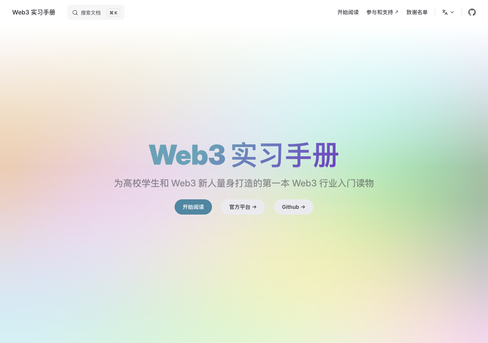
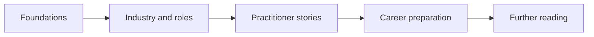

# Web3 Internship Handbook · Learning Fork

**English** · [简体中文](README.zh-CN.md)

Curiosity about a new field gets easier when someone is willing to explain the basics.

Bill306's learning fork of the Web3 Internship Handbook, an educational project initiated by **ETHPanda and LXDAO**. The handbook belongs to its upstream authors and contributors. Its chapter content is primarily Chinese; this English README provides an entry guide.

## Find a starting point

| Area | Chapters |
| --- | --- |
| Foundations | [Blockchain basics](docs/zh/part1/blockchain-basic.md), [Ethereum](docs/zh/part1/overview-of-ethereum.md), [industry areas](docs/zh/part1/industry-knowledge.md), [remote work](docs/zh/part1/remote-work-guide.md) |
| Career paths | [Roles](docs/zh/part2/position-introduction.md), [smart contracts](docs/zh/part2/smart-contract-development.md), [community work](docs/zh/part2/community-intern.md), [security](docs/zh/part2/security.md) |
| Practitioner stories | [Logic](docs/zh/part3/Logic.md), [Jason](docs/zh/part3/Jason.md), [Julie](docs/zh/part3/Julie.md), [Bruce](docs/zh/part3/Bruce.md) |
| Job preparation | [Resume](docs/zh/part4/write-resume.md), [interviews](docs/zh/part4/interview-preparedness.md), [job platforms](docs/zh/part4/job-platform.md) |
| Further reading | [Glossary, resources, questions, and tools](docs/zh/part5/part5.md) |

Start with [the chapter index](docs/zh/README.md). For example, follow blockchain basics with the role overview, then write down the questions you want to investigate through a small project or conversation.

## Contribute with the community

Read [CONTRIBUTING.md](CONTRIBUTING.md) for corrections, new material, and experience sharing. [Acknowledgments](docs/zh/acknowledgments.md) records contributors. The Chinese README preserves upstream community links and the handbook's full introduction.

Program dates and recruitment notices in the source material are historical; check the organizers' current announcements before applying.

## Attribution and terms

This fork preserves upstream authorship. The upstream README states MIT and CC BY-NC-SA 4.0 terms and a restriction on unauthorized printing/sale. Review the repository's applicable notices and content terms before redistribution.
